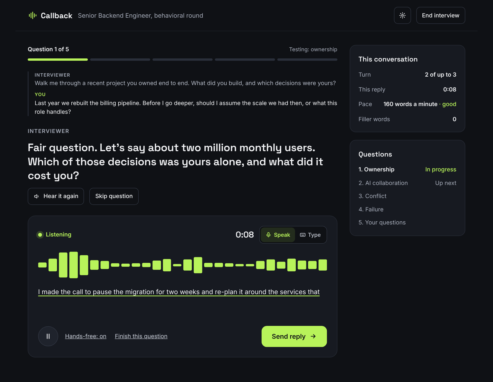
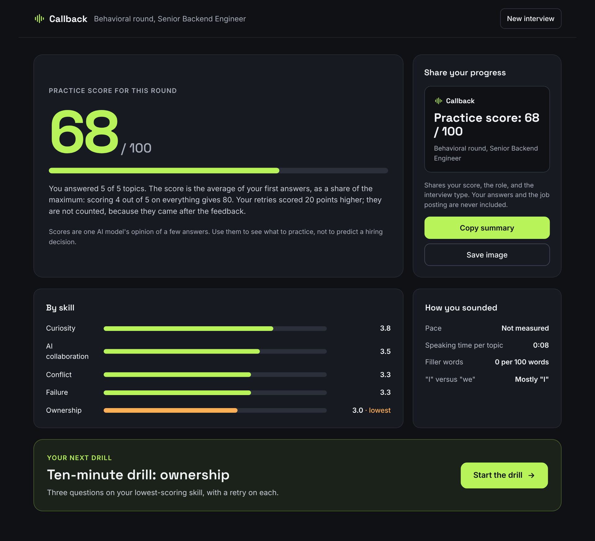

# Callback

[](https://github.com/utsabpanta/interview-coach/actions/workflows/pages.yml)
[](LICENSE)

**Paste a job posting. Be in the interview in 60 seconds.**

Callback is an open-source app for spoken interview practice. It reads a job posting, holds a
two-way interview with you out loud for that exact role, and after every topic gives you the one
thing to fix and a second attempt to prove it. It is free to use with open models, needs no
signup, and has no server.

**[Try it in your browser →](https://utsabpant.com/interview-coach/)**



## Why Callback

- **A real conversation.** The interviewer reacts to what you say, answers your clarifying questions, pushes back on vague claims, and moves on when a topic is covered. You talk; your words are transcribed as you speak.
- **It listens.** Stop talking and the interviewer takes its turn, with no button to press. Say "can you repeat the question?" or "could you rephrase that?" and it does.
- **Interviews the way they are run now.** Questions are practical and close to the job: project deep dives, production incidents, reviewing AI-generated code, designing AI-powered features, and how you work with AI tools. No brainteasers, trivia, or "greatest weakness".
- **Your turn to ask.** Each round ends with your questions for the interviewer, and those are scored too.
- **One fix, then retry.** Each conversation is scored on structure, specificity, relevance, and concision, with a single most important change and a before-and-after comparison when you try again.
- **A readiness score for the role.** The scorecard shows where you stand by skill, how you sounded (pace, filler words, "I" versus "we"), and a ten-minute drill on your weakest skill.
- **Free and open models.** Use a free hosted tier (Groq, Google Gemini, OpenRouter), a model running on your own computer (Ollama, LM Studio), or Claude.
- **No signup and no server.** The app is a static site. It runs in your browser and talks straight to the model provider you choose; your history never leaves that browser.

| Start from a job posting | Fix one thing, then retry | See where you stand |
| --- | --- | --- |
|  |  |  |

Screenshots show the built-in sample data, not output from a real model.

## Quick start

1. Open **[utsabpant.com/interview-coach](https://utsabpant.com/interview-coach/)** in Chrome, Edge, or Safari.
2. Get a free API key from [Groq](https://console.groq.com/keys) (no credit card), or pick another provider.
3. Paste a job description, press **Start interview**, and enter the key when asked.

Prefer to keep everything on your machine? Run it locally with [Ollama](#model-providers).

## Run it locally

Requires Node.js 20 or later.

```bash
git clone https://github.com/utsabpanta/interview-coach.git
cd interview-coach/web
npm install
npm run dev
```

Open the address it prints, paste a job description, and press **Start interview**. The first
time, it asks which model provider to use.

### Model providers

| Provider | Cost | What you need |
| --- | --- | --- |
| Groq (default) | Free tier, no card | A key from [console.groq.com](https://console.groq.com/keys) |
| Google Gemini | Free tier on selected models | A key from [aistudio.google.com](https://aistudio.google.com/apikey) |
| OpenRouter | Free models (`:free`), low daily cap | A key from [openrouter.ai](https://openrouter.ai/keys) |
| Ollama | Free, runs on your computer | [Ollama](https://ollama.com) running locally with a model pulled |
| Anthropic Claude | Paid | A key from [console.anthropic.com](https://console.anthropic.com/) |
| Other | Depends | Any OpenAI-compatible server address, such as LM Studio or vLLM |

Model names and free-tier limits change often. In Settings, **Check connection** lists the models
your provider offers right now, so you can pick one instead of relying on the built-in default.

**Using Ollama.** A web page may only call Ollama if Ollama allows that page's address. Start it
with the address the app is served from, for example:

```bash
ollama pull llama3.2
OLLAMA_ORIGINS=http://localhost:5173 ollama serve
```

Settings shows the exact command for the address you are on. Some browsers block a hosted (https)
page from calling a local server; if that happens, run the app locally as above.

**Which model?** Feedback quality depends on the model. Larger models give sharper, more specific
feedback; small local models are usable but looser, and may be slow without a GPU. One interview
makes roughly 15 to 25 model calls, one for each interviewer reply and each score, which matters
on free tiers with daily caps.

To try the flow without a key, open the dev server with `?mock=1` (for example
`http://localhost:5173/?mock=1`). This uses a scripted stand-in for the model, so the questions
and feedback are canned; it exists for development and is not included in production builds.

### Browser support

Voice uses the browser's built-in speech features. Chrome, Edge, and Safari support speech
recognition; in other browsers, or if the microphone is blocked, Callback falls back to typed
answers. Pace is only measured for spoken answers.

### Deploying

`npm run build` in `web/` produces a static site in `web/dist` that can be hosted anywhere. The
included GitHub Actions workflow tests the project and publishes it to GitHub Pages on every push
to `main`; turn it on once under **Settings → Pages → Source: GitHub Actions**.

## Privacy

Callback has no backend, accounts, or analytics. What that means in practice:

- **Your API keys** are stored in your browser's local storage and each is sent only to its own provider.
- **The job posting, your resume, and your answers** are sent to the model provider you chose, to plan questions and score answers. Callback stores them nowhere, and they are gone when you close the tab. With Ollama or another local server, they never leave your computer.
- **Free hosted tiers may use what you send to improve their services.** Check the provider's terms before pasting anything private, or use a local model.
- **Your history** keeps scores only (role, date, readiness, skill scores), in local storage.
- **Speech recognition is done by your browser**, not by Callback. Some browsers, including Chrome, send audio to their vendor's speech service to transcribe it. Use typed answers if you do not want that.
- **The share card** contains scores only.

Because keys live in the browser, prefer free-tier keys or keys with a spending limit, and only run
builds of Callback that you trust.

## How a round runs

| Round | Topics | Turns per topic |
| --- | --- | --- |
| Behavioral | 4, then your questions | up to 3 |
| Technical | 3, then your questions | up to 4 |
| System design | 2, then your questions | up to 6 |

A turn is one thing you say. After each, the interviewer replies: it may answer a question you
asked, probe further, change a requirement, or wrap up the topic. You can end a topic early with
**Finish this question**. Turning off two-way conversation in Settings gives one answer per
question instead.

### Talking to the interviewer

The interview is hands-free by default. When you stop talking, the interviewer waits, shows a
short countdown, and then replies; keep talking and the countdown resets. It is built to err on
the side of letting you finish.

| You say | What happens |
| --- | --- |
| An answer, then silence | The interviewer responds after about 5.5 seconds. It waits longer if you have only just started or stopped mid-sentence ("...and", "...because"). |
| "Can you repeat the question?", "Sorry, I didn't catch that" | It says the question again. Your words are not used as an answer; if they were meant as one, press **That was my answer**. |
| "Could you rephrase that?", "What do you mean by that?" | The interviewer is asked to rephrase or clarify, and told not to count it against you or use up one of your turns. |
| "...and that's my answer", "that's all I have" | It takes its turn right away, and the sign-off is left out of your answer. |

If it replies before you finished, press **I wasn't finished**: your reply is taken back, what you
said is kept, and you carry on from where you stopped. The interviewer waits longer after that.

Other controls:

- **I'm still thinking**, during the countdown, makes the interviewer wait until you press **Send reply**.
- **Pause** stops the microphone. Resuming never sends what you said before the pause.
- **Hands-free: on/off**, on the interview screen, switches automatic replies off entirely.
- **Settings** (the gear icon, also available mid-interview) sets how long the interviewer waits: about 3.5, 5.5, or 8 seconds.

The microphone is off while the interviewer is speaking, so wait for it to finish, or press
**Start answering** to cut in. Only requests that are unmistakable are handled on the spot;
anything else you say is treated as part of your answer and sent to the interviewer.

Question quality depends on the model you choose. The interviewer is told today's date and asked
to follow current practice, but a small or older model will still drift toward generic questions.

## How scoring works

Every conversation gets four scores from 1 to 5. The readiness score is the average across your answers
(each question counted at its latest attempt) as a percentage of the maximum; 80 is marked as
interview-ready. Delivery metrics are computed locally, without a model: word count, speaking
time, filler words, and pronoun use.

The coach is instructed never to invent facts about you. Rewritten answers use only what you said
and mark missing details with placeholders such as `[metric]`.

## Command-line tool

The repository also contains `coach`, a terminal version with extra tools: analysis of recorded
audio, a story bank built from your resume, progress tracking, and a pipeline that turns project
notes into a technical document and a slide storyline. See [docs/cli.md](docs/cli.md).

## Development

```bash
# Shared logic and CLI (repository root)
npm install
npm test
npm run typecheck

# Web app
cd web
npm install
npm test
npm run build
```

```
src/                 coaching logic shared by the web app and the CLI
  coach.ts           prompts: plan questions, follow up, evaluate
  openai.ts          client for any OpenAI-compatible model API
  metrics.ts         local delivery metrics
  pacing.ts          pace and pause analysis
  cli.ts, ...        the command-line tool
web/
  src/App.tsx        session state and screen flow
  src/screens/       start, live interview, feedback, scorecard
  src/lib/           providers, speech, scoring, storage, share card
docs/cli.md          command-line documentation
```

## Contributing

Contributions are welcome, especially better interview guidance for specific roles, support for
more languages, and fixes for browsers or model providers that misbehave. See
[CONTRIBUTING.md](CONTRIBUTING.md) for how to set up, test, and send a change.

If Callback helped you prepare, a star helps other people find it.

## Roadmap

- Interview on your own code: connect GitHub repos and get questions about your real design decisions.
- Community question packs for specific roles and companies.
- An in-browser model option that needs no key and no install.
- A hosted demo that needs no API key.
- Daily drill reminders and progress over time.

## License

[MIT](LICENSE). Use it, change it, and ship it, as long as the license notice stays with the code.
