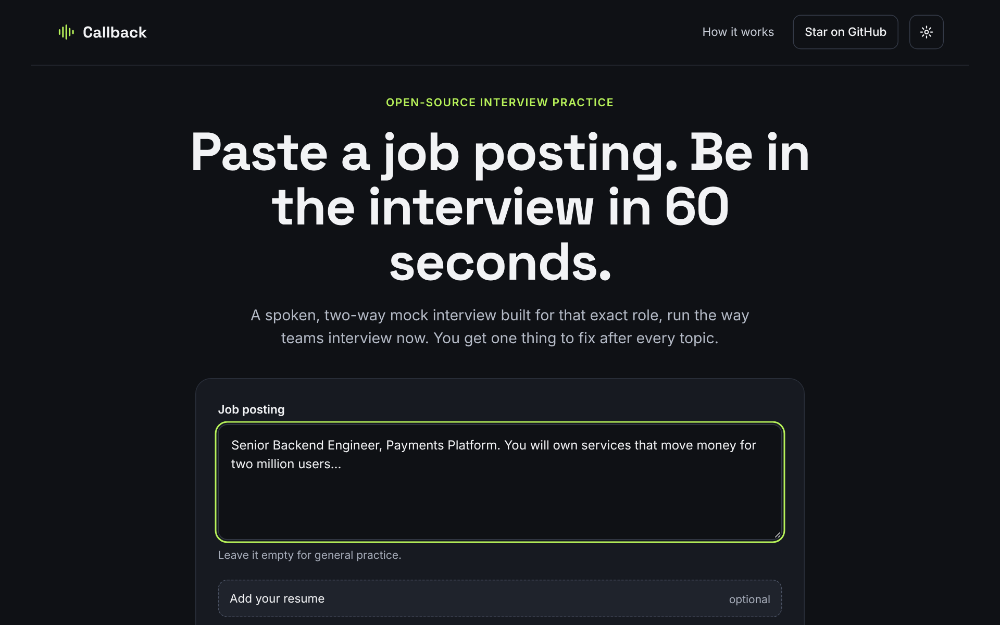
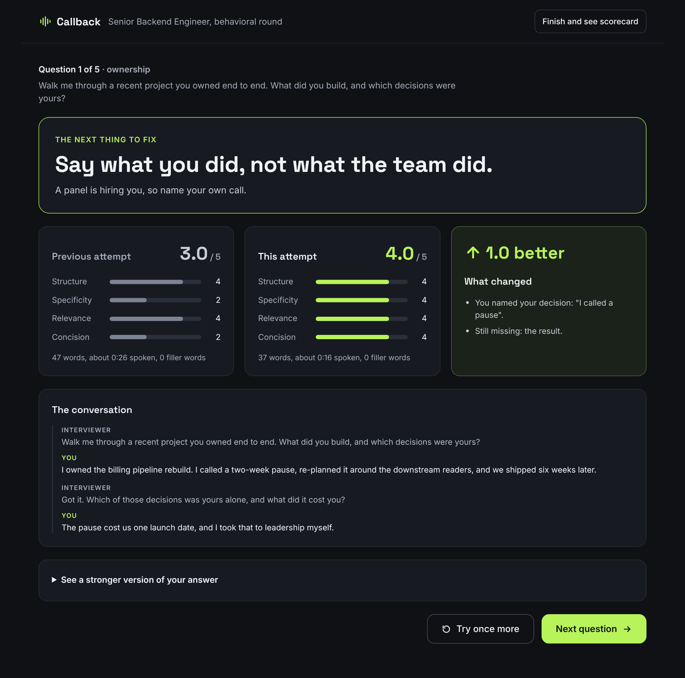

# Callback

[](https://github.com/utsabpanta/interview-coach/actions/workflows/pages.yml)
[](LICENSE)

**Paste a job posting. Be in the interview in 60 seconds.**

Callback is an open-source app for spoken interview practice. It reads a job posting, holds a
two-way interview with you out loud for that exact role, and after every topic gives you the one
thing to fix and a second attempt to prove it. It is free, needs no signup and no server, and can
run entirely on your own computer.

**[Try it in your browser →](https://utsabpant.com/interview-coach/)**


*Answer out loud or by typing. Switch between the two at any point, even mid-answer.*

## Why Callback

- **A real conversation.** The interviewer reacts to what you say, answers your clarifying questions, pushes back on vague claims, and moves on when a topic is covered. You talk; your words are transcribed as you speak.
- **Speak or type.** Answer out loud, or flip the switch to Type when you are somewhere quiet or have no microphone. What you have said so far carries over, and you can switch back.
- **It listens.** Stop talking and the interviewer takes its turn, with no button to press. Say "can you repeat the question?" or "could you rephrase that?" and it does.
- **Interviews the way they are run now.** Questions are practical and close to the job: project deep dives, production incidents, reviewing AI-generated code, designing AI-powered features, and how you work with AI tools. No brainteasers, trivia, or "greatest weakness".
- **Your turn to ask.** Each round ends with your questions for the interviewer, and those are scored too.
- **One fix, then retry.** Each conversation is scored on structure, specificity, relevance, and concision, with a single most important change and a before-and-after comparison when you try again.
- **A practice score that doesn't oversell.** The scorecard shows where you stand by skill, how you sounded (pace, filler words, "I" versus "we"), and a ten-minute drill on your lowest-scoring skill. It won't put a number on a round you mostly skipped.
- **Coaching on the exact words you used.** The transcript comes back with coaching points attached to the phrases they are about, and a breakdown of your filler words.
- **A notes pad for technical rounds.** Sketch an outline, pseudo-code, or a design in text; the interviewer reads it along with what you say.
- **Role packs written by the community.** Guidance on what interviews for a kind of role really probe: backend, frontend, product, data, management, new graduates. [Add your own](packs/README.md).
- **Free and open models, or no key at all.** Use a free hosted tier (Groq, Google Gemini, OpenRouter), a model on your own computer (Ollama, LM Studio), a model that runs inside your browser, or Claude.
- **No signup and no server.** The app is a static site. It runs in your browser and talks straight to the model provider you choose; your history never leaves that browser.

| Start from a job posting | Fix one thing, then retry | See where you stand |
| --- | --- | --- |
|  |  |  |

Screenshots show the built-in sample data, not output from a real model.

## Quick start

1. Open **[utsabpant.com/interview-coach](https://utsabpant.com/interview-coach/)** in Chrome, Edge, or Safari.
2. Paste a job description and press **Start interview**.
3. Choose a model when asked:
   - **Fastest and best feedback:** a free API key from [Groq](https://console.groq.com/keys), no credit card.
   - **No key at all:** choose **On this device**. A small model downloads once (about 2 GB) and runs in your browser. This is experimental; see [Model providers](#model-providers).

Prefer to keep everything on your machine with a stronger model? Run it with [Ollama](#model-providers).

## Run it locally

Requires Node.js 20 or later.

```bash
git clone https://github.com/utsabpanta/interview-coach.git
cd interview-coach/web
npm install
npm run dev
```

Open the address it prints, paste a job description, and press **Start interview**. The first
time, it asks which model provider to use.

### Model providers

| Provider | Cost | What you need |
| --- | --- | --- |
| Groq (default) | Free tier, no card | A key from [console.groq.com](https://console.groq.com/keys) |
| Google Gemini | Free tier on selected models | A key from [aistudio.google.com](https://aistudio.google.com/apikey) |
| OpenRouter | Free models (`:free`), low daily cap | A key from [openrouter.ai](https://openrouter.ai/keys) |
| Ollama | Free, runs on your computer | [Ollama](https://ollama.com) running locally with a model pulled |
| On this device (experimental) | Free, runs in your browser | A computer with a recent graphics chip, Chrome or Edge, and a one-time download of 2 to 5 GB |
| Anthropic Claude | Paid | A key from [console.anthropic.com](https://console.anthropic.com/) |
| Other | Depends | Any OpenAI-compatible server address, such as LM Studio or vLLM |

Model names and free-tier limits change often. In Settings, **Check connection** lists the models
your provider offers right now, so you can pick one instead of relying on the built-in default.

**Using Ollama.** A web page may only call Ollama if Ollama allows that page's address. Start it
with the address the app is served from, for example:

```bash
ollama pull llama3.2
OLLAMA_ORIGINS=http://localhost:5173 ollama serve
```

Settings shows the exact command for the address you are on. Some browsers block a hosted (https)
page from calling a local server; if that happens, run the app locally as above.

**On this device.** The model runs inside the browser through [WebLLM](https://github.com/mlc-ai/web-llm),
so there is no key, no account, and nothing is sent to a model provider. It is the easiest way to
try Callback and the most private, but it is experimental: small models ask blander questions and
give rougher feedback, the first load is a large download, and it needs WebGPU, which phones and
older computers may not have. If it does not work for you, a free Groq key is the next easiest
option.

**Free-tier limits.** Free tiers cap requests and words per minute. When a limit is hit
mid-interview, Callback waits as long as the provider asks, shows a short notice, and carries on;
nothing is lost. A daily quota cannot be waited out, so the app says so and you can switch
provider in Settings. Very long job postings and resumes are trimmed before they are sent, which
keeps each request small.

**Which model?** Feedback quality depends on the model. Larger models give sharper, more specific
feedback; small local models are usable but looser, and may be slow without a GPU. One interview
makes roughly 15 to 25 model calls, one for each interviewer reply and each score, which matters
on free tiers with daily caps.

To try the flow without a key, open the dev server with `?mock=1` (for example
`http://localhost:5173/?mock=1`). This uses a scripted stand-in for the model, so the questions
and feedback are canned; it exists for development and is not included in production builds.

### Browser support

Voice uses the browser's built-in speech features. Chrome, Edge, and Safari support speech
recognition; in other browsers, or if the microphone is blocked, Callback falls back to typed
answers. Pace is only measured for spoken answers.

### Deploying

`npm run build` in `web/` produces a static site in `web/dist` that can be hosted anywhere. The
included GitHub Actions workflow tests the project and publishes it to GitHub Pages on every push
to `main`; turn it on once under **Settings → Pages → Source: GitHub Actions**.

## Guardrails

An interview is a professional conversation, and practice should be too. Callback applies two
layers: instructions given to the model on every request, and checks on what the model sends back.

| Situation | What Callback does |
| --- | --- |
| The interviewer would ask about age, family, religion, origin, health, or another protected topic | The model is told never to. A reply or planned question that does anyway is withheld and replaced with a neutral follow-up. |
| The interviewer or the feedback would swear at, insult, or belittle you | Same: told not to, and withheld if it happens. Insulting feedback items are dropped; scores are kept. |
| You swear or are rude | The interviewer stays calm and carries on, without a lecture. The feedback mentions once that it would count against you in a real interview. |
| You say something that suggests real distress or thoughts of self-harm | The interview pauses, nothing from that answer is scored, and you are pointed to emergency and crisis support. You can end the session or carry on. |
| A job posting, resume, or question pack contains instructions meant for the AI | The model is told to treat all of it as material to read, never as instructions. |

These reduce bad behavior; they cannot rule it out. The checks are simple English patterns, and
how well a model follows instructions varies, with small local and on-device models the least
reliable. The distress check errs toward noticing, so it will sometimes pause over a figure of
speech. Callback is a practice tool and not a source of mental health support. If you see the
interviewer say something it should not, please
[report it](https://github.com/utsabpanta/interview-coach/issues/new/choose).

## Privacy

Callback has no backend, accounts, or analytics, and loads nothing from other sites: fonts and
scripts are served with the app. What that means in practice:

- **The job posting, your resume, and your answers** are sent to the model provider you chose, to plan questions and score answers. Callback stores them nowhere, and they are gone when you close the tab. With Ollama or another local server, they are not sent to any provider.
- **Free hosted tiers may use what you send to improve their services.** Check the provider's terms before pasting anything private, or use a local model.
- **Speech recognition is done by your browser**, not by Callback. Some browsers, including Chrome, send audio to their vendor's speech service to transcribe it, even when you use a local model. Use typed answers if you do not want that.
- **The natural voice is optional.** If you turn it on, the interviewer's words (not yours) are sent to Groq to be turned into audio.
- **Your history** keeps scores only (role, date, score, skill scores), in this browser. **Delete practice history** in Settings removes it.
- **Sharing** includes your score, the role, and the interview type. Your answers and the job posting are never included.

### Your API keys

Keys are stored in your browser and each is sent only to its own provider. Three things to know:

- **Browser storage is shared by every page at the same web address.** If you host Callback under a path of a larger site (as the demo is), other pages on that site could read the keys. Hosting it on its own subdomain avoids this.
- **You control how long keys are kept.** Turn off **Remember my API keys on this device** in Settings to keep them only until the tab is closed, and use **Remove saved API keys** to delete them.
- **Limit the damage a leaked key could do.** Prefer free-tier keys or keys with a spending limit, and only run builds of Callback that you trust.

The built site sends a Content-Security-Policy that allows only its own scripts to run, blocks
embedding and form submission, and limits network requests to HTTPS and to this computer.

## How a round runs

| Round | Topics | Turns per topic |
| --- | --- | --- |
| Behavioral | 4, then your questions | up to 3 |
| Technical | 3, then your questions | up to 4 |
| System design | 2, then your questions | up to 6 |

A turn is one thing you say. After each, the interviewer replies: it may answer a question you
asked, probe further, change a requirement, or wrap up the topic. You can end a topic early with
**Finish this question**. Turning off two-way conversation in Settings gives one answer per
question instead.

### Talking to the interviewer

The interview is hands-free by default. When you stop talking, the interviewer waits, shows a
short countdown, and then replies; keep talking and the countdown resets. It is built to err on
the side of letting you finish.

| You say | What happens |
| --- | --- |
| An answer, then silence | The interviewer responds after about 5.5 seconds. It waits longer if you have only just started or stopped mid-sentence ("...and", "...because"). |
| "Can you repeat the question?", "Sorry, I didn't catch that" | It says the question again. Your words are not used as an answer; if they were meant as one, press **That was my answer**. |
| "Could you rephrase that?", "What do you mean by that?" | The interviewer is asked to rephrase or clarify, and told not to count it against you or use up one of your turns. |
| "...and that's my answer", "that's all I have" | It takes its turn right away, and the sign-off is left out of your answer. |

If it replies before you finished, press **I wasn't finished**: your reply is taken back, what you
said is kept, and you carry on from where you stopped. The interviewer waits longer after that.

Other controls:

- **I'm still thinking**, during the countdown, makes the interviewer wait until you press **Send reply**.
- **Pause** stops the microphone. Resuming never sends what you said before the pause.
- **Hands-free: on/off**, on the interview screen, switches automatic replies off entirely.
- **Settings** (the gear icon, also available mid-interview) sets how long the interviewer waits: about 3.5, 5.5, or 8 seconds.

The microphone is off while the interviewer is speaking, so wait for it to finish, or press
**Start answering** to cut in. Only requests that are unmistakable are handled on the spot;
anything else you say is treated as part of your answer and sent to the interviewer.

### The interviewer's voice

Settings has two kinds of voice, each with a **Hear this voice** preview:

| Voice | Sounds like | Cost and privacy |
| --- | --- | --- |
| Browser voice (default) | Depends on your browser. Edge's "Natural" voices are the best free ones, Chrome's "Google" voices are next, and Safari uses your system voices. | Free. Callback picks the most natural voice installed, and you can choose another. |
| Natural voice by Groq | A neural voice that sounds human, with five voices to choose from. | Uses your Groq key, and Groq bills speech by the character. The interviewer's words are sent to Groq to be spoken. |

If the natural voice fails (no key, terms not accepted in Groq's console, a rate limit), the
browser voice takes over and a notice says why. On a Mac you can install better system voices in
System Settings under Accessibility, Spoken Content.

Question quality depends on the model you choose. The interviewer is told today's date and asked
to follow current practice, but a small or older model will still drift toward generic questions.

## How scoring works

Every conversation gets four scores from 1 to 5: structure, specificity, relevance, and concision.
The practice score is the average across the topics you answered, as a percentage of the maximum,
so scoring 4 out of 5 on everything gives 80.

The score is one AI model's opinion of a few answers. It is there to show what to practice, not to
predict a hiring decision, and the app is built not to overstate it:

- **First answers count.** A retry comes after you have read the feedback and a model-written
  better answer, so retries are reported separately and do not raise the score.
- **Too little is not scored.** You need at least three answered topics, and at least half the
  round, before a number is shown.
- **Progress compares like with like.** "Up 9 since your last round" compares only with an earlier
  session for the same role, interview type, and kind (a full round, or a drill on the same skill).
- **No invented scores.** If the model's evaluation is missing a score or is out of range, the app
  reports an error and offers to score again instead of filling in a number.
- **Quotes are checked.** A phrase is shown as "from what you said" only if it appears in your
  answers.

Delivery metrics are computed locally, without a model: word count, speaking time, filler words,
and pronoun use. Pace is measured from the time you spent speaking, not waiting.

The coach is instructed not to invent facts about you, and rewritten answers mark missing details
with placeholders such as `[metric]`. That is an instruction to the model, not a guarantee, so
check a rewrite against what really happened before you use it.

## Command-line tool

The repository also contains `coach`, a terminal version with extra tools: analysis of recorded
audio, a story bank built from your resume, progress tracking, and a pipeline that turns project
notes into a technical document and a slide storyline. See [docs/cli.md](docs/cli.md).

## Development

```bash
# Shared logic and CLI (repository root)
npm install
npm test
npm run typecheck

# Web app
cd web
npm install
npm test
npm run build
```

```
src/                 coaching logic shared by the web app and the CLI
  coach.ts           prompts: plan questions, follow up, evaluate
  openai.ts          client for any OpenAI-compatible model API
  guardrails.ts      conduct rules and checks on what the interviewer says
  metrics.ts         local delivery metrics
  pacing.ts          pace and pause analysis
  cli.ts, ...        the command-line tool
web/
  src/App.tsx        session state and screen flow
  src/screens/       start, live interview, feedback, scorecard
  src/lib/           providers, on-device model, speech recognition, voice, scoring, storage, packs
packs/               community question packs, one JSON file per kind of role
docs/cli.md          command-line documentation
```

## Contributing

Contributions are welcome, especially better interview guidance for specific roles, support for
more languages, and fixes for browsers or model providers that misbehave. See
[CONTRIBUTING.md](CONTRIBUTING.md) for how to set up, test, and send a change.

If Callback helped you prepare, a star helps other people find it.

## Roadmap

Help is welcome on any of these; open an issue to talk it through first.

- **Other languages.** Speech recognition, filler-word detection, and request detection are English-only today.
- **A drawing whiteboard** for system design, beyond the text notes pad.
- **Checking the scores.** A small public set of answers scored by experienced interviewers, to measure how well each model's scoring agrees with people.
- **More role packs**, especially outside software.
- **Interview on your own code**: questions about the real decisions in a repository you point it at.
- **Keeping a conversation across a page reload.**
- **Phones.** The layout works on small screens, but voice on mobile browsers is untested.

## How it compares

| | Callback | Paid interview simulators | Speech coaches | General chat assistants |
| --- | --- | --- | --- | --- |
| Cost | Free | Subscription | Free tier, then subscription | Free tier, then subscription |
| Signup | None | Required | Required | Usually required |
| Tailored to a job posting | Yes | Yes | Partly | If you prompt it |
| Two-way spoken interview | Yes | Yes | Yes | With voice mode |
| Fix one thing, then retry | Yes | Varies | Varies | No |
| Can run fully on your computer | Yes | No | No | No |
| Open source | Yes | No | No | No |
| Video and body-language feedback | No | Some | Yes | No |
| Drawing whiteboard, code execution | No | Some | No | No |
| Large curated question libraries | No | Yes | No | No |

Callback is a young project. It has been tested with simulated microphones and models far more
than with real ones, so expect rough edges and please report them.

## License

[MIT](LICENSE). Use it, change it, and ship it, as long as the license notice stays with the code.
